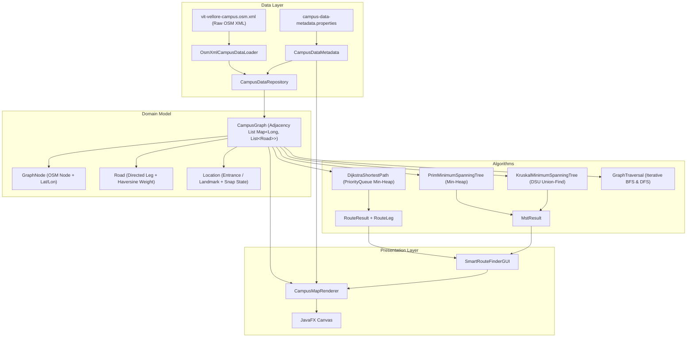

# Smart Route Finder — VIT Vellore Campus

A Java desktop application and PAMCA501 Data Structures and Algorithms (DSA) project for finding shortest mapped walking routes and analyzing network connectivity across the VIT Vellore campus using real OpenStreetMap (OSM) vector geometry.

> **Status:** Fully implemented, verified release. Features a modular, decoupled architecture, raw OSM XML parser, 1,643-vertex campus walking graph, equirectangular vector map renderer with interactive zoom and pan controls, real-time searchable landmark dropdowns, Dijkstra shortest-path routing with step-by-step turn directions, Prim and Kruskal minimum spanning forest algorithms, Disjoint Set Union (DSU), BFS/DFS diagnostics, and 7 automated test suites (100% passing).

---

## 1. Project Overview & Features

- **Interactive Vector Map with Smooth Zoom & Pan:** Renders physical walkways, service roads, crossings, and 198 selectable campus landmarks from a local, version-controlled OpenStreetMap XML snapshot. Supports interactive mouse wheel zooming (centered at the cursor), mouse drag panning, dedicated toolbar zoom controls (`➕ Zoom In`, `➖ Zoom Out`, `⟲ Fit to Screen`), and an on-canvas zoom percentage badge.
- **Real-Time Searchable Landmark Selection:** Find any campus building, lab, hostel, or kiosk by typing its name directly into the Start or Destination dropdowns with instant auto-filtering, or by clicking landmark markers directly on the map canvas.
- **Shortest Walking Route (Dijkstra):** Calculates minimum-distance walking paths ($O((V + E) \log V)$) using a min-heap priority queue and adjacency list, providing step-by-step leg distances, way names, and total metres.
- **Reliable Campus Connectivity:** Pedestrian zebra crossings (`highway=crossing`) connect pathways across campus roads, and **Main Component Priority Snapping** connects landmarks to the main campus walking spine, ensuring dependable end-to-end routing.
- **Spanning Network Analysis (Prim & Kruskal MST):** Computes minimum spanning trees/forests to demonstrate global network optimization ($O((V + E) \log V)$ and $O(E \log E)$), highlighting the distinction between point-to-point shortest routes and minimum connecting infrastructure.
- **Disjoint Set Union (DSU):** Implements path compression and union-by-rank ($O(\alpha(V))$) for cycle detection in Kruskal's algorithm.
- **Graph Diagnostics (BFS & DFS):** Discovers connected components and traverses reachable subgraphs in $O(V + E)$ time.
- **Offline & Autonomous:** Operates completely offline without sending runtime requests to Overpass or raster tile servers.
- **Full Attribution:** Features persistent on-map OpenStreetMap attribution under the Open Database License (ODbL).

---

## 2. Quick Start: How to Run the Project (For Faculty & Students)

### 🚀 1-Click Launch (Running the Application)
- **Windows Command Prompt / Explorer:** Double-click or run `run.bat`
- **Windows PowerShell:** Run `.\run.ps1`

### 🔨 1-Click Build (Compiling Sources)
- **Windows Command Prompt / Explorer:** Double-click or run `build.bat`
- **Windows PowerShell:** Run `.\build.ps1`

### 🧪 1-Click Test Runner (7 Automated Test Suites)
- **Windows Command Prompt / Explorer:** Double-click or run `test.bat`
- **Windows PowerShell:** Run `.\test.ps1`
*(Executes all 7 test suites validating graph invariants, data loading, Dijkstra shortest path, Prim/Kruskal equivalence, Canvas rendering, and user experience flows).*

### 🎮 How to Use the Desktop Application
1. **Searchable Landmark Selection:** Click into either the **Start Location** or **Destination** box and type any building or place name (e.g., *"Library"*, *"Food Court"*, *"Gate"*, *"Tower"*, *"Block"*). Matching campus landmarks are filtered in real-time as you type. Alternatively, click directly on any blue landmark dot on the vector map canvas.
2. **Interactive Map Navigation:**
   - **Zoom In / Out:** Rotate your mouse scroll wheel (zooms smoothly centered at the mouse cursor), or click `➕ Zoom In` / `➖ Zoom Out` in the map toolbar.
   - **Pan:** Click and drag anywhere across the map canvas to freely pan the viewport.
   - **Fit to Screen:** Click `⟲ Fit to Screen` to reset zoom and recenter the campus map.
3. **Find Shortest Route (Dijkstra):** Click **Find Shortest Route**. The optimal walking path is traced in bright orange-red with step junction markers, and step-by-step turn directions with individual leg distances and walkway names appear in the sidebar.
4. **Minimum Spanning Network (Prim MST):** Click **Show Minimum Network**. The lowest-cost connecting walkway tree/forest is highlighted in forest green, and network length metrics are displayed in the sidebar.
5. **Reset:** Click **Reset** to clear active overlays, selections, and restore the initial map view.

---

## 3. Architecture & Separation of Concerns



### Decoupled Components

1. **Data Layer (`com.smartroute.data`):** Secure DOM parsing (XXE/DTD disabled), tag allowlist filtering (`highway=footway, pedestrian, path, steps, service, residential, living_street, crossing, unclassified, track`), access denylist (`foot=no`, `access=no`), duplicate name disambiguation, and configurable 50.0-metre main-component priority proximity snapping.
2. **Model Layer (`com.smartroute.model`):** Pure graph domain representations: immutable `GraphNode`, bidirectional `Road` edges with Haversine distance calculations in metres, `Location` POIs, in-memory name searching (`searchLocationsByName`), and sparse adjacency list `CampusGraph`.
3. **Algorithm Layer (`com.smartroute.algorithm`):** Standalone, headless algorithm implementations returning immutable result containers (`RouteResult`, `MstResult`). Zero UI dependencies.
4. **UI Layer (`com.smartroute.ui` & root):** `CampusMapRenderer` handles equirectangular projection preserving local aspect ratio, viewport zooming/panning transformations, vector walkway painting, route/MST overlays, and click hit-testing. `SmartRouteFinderGUI` coordinates searchable dropdowns, zoom toolbar controls, mouse drag panning, and directions readouts.

---

## 4. PAMCA501 DSA Syllabus Mapping

| Syllabus Topic | Class / Implementation | Time Complexity | Space Complexity | Verification Status |
|---|---|---|---|---|
| **Graph Representation** | `CampusGraph`, `GraphNode`, `Road` | Adjacency List: $O(V + E)$ | $O(V + E)$ | Tested (`CampusGraphTest`) |
| **Hash Tables / Sets** | `CampusGraph`, `DijkstraShortestPath` | Lookup: $O(1)$ average | $O(V)$ | Tested (`CampusGraphTest`) |
| **Geodesic Distance** | `CampusGraph.calculateHaversineDistance` | Spherical math: $O(1)$ | $O(1)$ | Tested against known coordinates |
| **Priority Queue / Min-Heap** | Java `PriorityQueue<NodeDistance>` | Insert/Extract: $O(\log V)$ | $O(V)$ | Tested (`DijkstraShortestPathTest`) |
| **Dijkstra Shortest Path** | `DijkstraShortestPath` | $O((V + E) \log V)$ | $O(V)$ | Tested (Relaxation, self-route, NO_PATH) |
| **Prim's MST** | `PrimMinimumSpanningTree` | $O((V + E) \log V)$ | $O(V)$ | Tested (Exact weight match with Kruskal) |
| **Kruskal's MST** | `KruskalMinimumSpanningTree` | $O(E \log E)$ | $O(V + E)$ | Tested (Exact weight match with Prim) |
| **Disjoint Set Union (DSU)** | `DisjointSet` | Path compression + rank: $O(\alpha(V))$ | $O(V)$ | Tested (Cycle detection, component count) |
| **Breadth-First Search (BFS)** | `GraphTraversal.bfs` | Queue exploration: $O(V + E)$ | $O(V)$ | Tested (Component discovery) |
| **Depth-First Search (DFS)** | `GraphTraversal.dfs` | Iterative LIFO stack: $O(V + E)$ | $O(V)$ | Tested (Traversal completeness) |

---

## 5. OpenStreetMap Dataset Provenance

- **Canonical File:** `src/main/resources/data/vit-vellore-campus.osm.xml` (1.50 MB, raw OSM XML).
- **Metadata File:** `src/main/resources/data/campus-data-metadata.properties`.
- **Bounding Box:** South `12.9640`, West `79.1500`, North `12.9790`, East `79.1670` (full VIT Vellore campus).
- **Verified Dataset Metrics:**
  - Total OSM nodes parsed: 6,084
  - Total OSM ways parsed: 1,032
  - Eligible walkable ways: 440 (including pedestrian footways, service paths, and crossings)
  - Routable graph vertices: 1,643
  - Walkway segments (edges): 1,793 bidirectional segments (3,586 directed edges)
  - Missing node references: 0 (100% integrity)
  - Disjoint graph components: 24 (reduced from 31 by crossing unification; main campus component contains 1,305 vertices)
  - Mapped campus landmarks: 198 places (179 snapped to walking graph, 174 directly connected to the main campus network)
- **Licensing & Attribution:** OpenStreetMap® data is licensed under the [Open Data Commons Open Database License](https://opendatacommons.org/licenses/odbl/) (ODbL) by the OpenStreetMap Foundation (OSMF). Persistent attribution: **“Map data © OpenStreetMap contributors”**.

---

## 6. Build, Test, and Execution Details

### Prerequisites
- JDK 21 or later (`javac` and `java` available in PATH).
- JavaFX 21 SDK (located in local Maven repository or system path).

### 1. Building the Project

Compile main sources, static resources, and test sources:

```powershell
.\build.ps1
```
*(or `build.bat` in Windows Command Prompt)*

### 2. Running All Automated Tests (7 Suites)

Execute the centralized test runner:

```powershell
.\test.ps1
```
*(or `test.bat` in Windows Command Prompt)*

Expected output:
```text
=================================================
       SMART ROUTE FINDER — AUTOMATED TESTS       
=================================================
[1/7] Running CampusGraphTest... -> PASSED
[2/7] Running CampusDataMetadataTest... -> PASSED
[3/7] Running OsmXmlCampusDataLoaderTest... -> PASSED
[4/7] Running DijkstraShortestPathTest... -> PASSED
[5/7] Running MstTest... -> PASSED
[6/7] Running CampusMapRendererTest... -> PASSED
[7/7] Running UserExperienceFlowTest... -> PASSED
=================================================
TEST RESULTS: 7 passed, 0 failed.
=================================================
```

### 3. Launching the Graphical Application

Launch the desktop GUI:

```powershell
.\run.ps1
```
*(or `run.bat` in Windows Command Prompt)*

---

## 7. Interactive Feature Walkthrough

1. **Search for Landmarks:** Type in the **START LOCATION** and **DESTINATION** boxes. As you type (e.g., "Library", "Food Court", "Gate", "Tower"), matching campus locations are filtered automatically. You can also click any blue landmark marker directly on the vector map canvas.
2. **Interactive Map Navigation:**
   - **Zoom:** Use the `➕ Zoom In` and `➖ Zoom Out` buttons in the toolbar, or rotate your mouse scroll wheel over the map.
   - **Pan:** Click and drag the map with your mouse to move the viewport in any direction.
   - **Fit View:** Click `⟲ Fit to Screen` to reset zoom and recenter the campus map.
3. **Calculate Shortest Route:** Click **Find Shortest Route**. The optimal walking path is highlighted in vibrant orange-red with step junction dots, and detailed step-by-step turns with distances and walkway names appear in the sidebar.
4. **Explore Minimum Spanning Network:** Click **Show Minimum Network**. The lowest-cost connecting walkway tree/forest is displayed in forest green, and network length metrics are reported in the sidebar.
5. **Clear / Reset:** Click **Reset** to clear active overlays, selections, and reset the viewport.

---

## 8. Repository Structure & File Guides

Every source, test, resource, query, and configuration file has a dedicated technical guide under [`docs/file-guides/`](docs/file-guides/):

```text
smart-route-finder-starter/
├── README.md                                  # Complete project documentation and viva guide
├── plan.md                                    # Authoritative SDLC plan, decisions, and verification
├── pom.xml                                    # Maven project configuration (JavaFX 21)
├── build.ps1 / build.bat                      # Standalone project compilation scripts
├── test.ps1 / test.bat                        # Automated test runner scripts
├── run.ps1 / run.bat                          # Desktop application launch scripts
├── data/overpass/vit-vellore-campus.overpassql# Overpass Turbo query template
├── src/main/java/com/smartroute/
│   ├── SmartRouteFinderGUI.java               # JavaFX UI controller with zoom, pan, and search
│   ├── model/
│   │   ├── GraphNode.java                     # Vertex model with latitude/longitude
│   │   ├── Road.java                          # Weighted edge model (Haversine metres)
│   │   ├── Location.java                      # Landmark POI model with snap states
│   │   └── CampusGraph.java                   # Adjacency list graph, search & invariant checks
│   ├── data/
│   │   ├── CampusDataMetadata.java            # Provenance, bounding box, ODbL attribution
│   │   ├── OsmXmlCampusDataLoader.java        # Secure XML parser, tag filtering, priority snapping
│   │   └── CampusDataRepository.java          # Cached singleton repository for graph/metadata
│   ├── algorithm/
│   │   ├── RouteLeg.java                      # Step leg value object (distance + way name)
│   │   ├── RouteResult.java                   # Shortest path result with explicit status
│   │   ├── DijkstraShortestPath.java          # O((V + E) log V) shortest path with min-heap
│   │   ├── MstResult.java                     # Spanning tree/forest result container
│   │   ├── DisjointSet.java                   # Union-Find with path compression & rank
│   │   ├── PrimMinimumSpanningTree.java       # Prim's MST O((V + E) log V)
│   │   ├── KruskalMinimumSpanningTree.java    # Kruskal's MST O(E log E)
│   │   └── GraphTraversal.java                # BFS and iterative DFS diagnostics
│   └── ui/
│       └── CampusMapRenderer.java             # Vector map equirectangular renderer with zoom/pan
├── src/main/resources/data/
│   ├── vit-vellore-campus.osm.xml             # Raw OpenStreetMap XML snapshot (1.50 MB)
│   └── campus-data-metadata.properties        # Verified provenance, bounds, filter settings
└── docs/
    ├── osm-data-specification.md              # Requirements and OSM tag filtering rules
    ├── campus-data-workflow.md                # Reproducible Overpass export and refresh SOP
    ├── demo-viva-script.md                    # Screen-by-screen demonstration script
    └── file-guides/                           # Comprehensive technical file guides
```

---

## 9. Viva Discussion Questions & Preparation (PAMCA501)

### Q1: Why use an adjacency list instead of an adjacency matrix for the campus map?
**Answer:** The VIT Vellore campus graph is very sparse. With $V = 1,643$ vertices, an adjacency matrix would require $V^2 \approx 2.7 \times 10^6$ entries ($O(V^2)$ memory), where over 99.8% of the cells would be null or zero. An adjacency list (`Map<Long, List<Road>>`) requires only $O(V + E)$ memory (1,643 entries with 3,586 directed edges total), and iterating through neighbors in Dijkstra and Prim takes $O(\text{deg}(v))$ time rather than $O(V)$ time.

### Q2: What is the exact difference between Dijkstra's shortest path and a Minimum Spanning Tree?
**Answer:** Dijkstra calculates the single-source shortest path minimizing the sum of edge weights between an origin and destination vertex ($O((V + E) \log V)$). An MST minimizes the total weight of connecting all vertices in a graph without cycles ($V - 1$ edges). A path along an MST is not necessarily the shortest route between two specific vertices.

### Q3: Why do Prim and Kruskal both yield identical total network weight on the campus graph?
**Answer:** By the Cut Property and Cycle Property of Minimum Spanning Trees, any valid MST on an undirected graph with real weights has the same optimal total weight. In `MstTest`, both Prim and Kruskal were executed on the campus snapshot and both yielded an identical minimum total network weight across all spanning trees.

### Q4: How does the application handle disconnected graph components in Dijkstra and MST?
**Answer:** 
- In Dijkstra: If the target vertex is unreachable from the start vertex, the distance remains `Double.POSITIVE_INFINITY` and the algorithm returns `RouteStatus.NO_PATH` with a clear explanation message, rather than looping infinitely or throwing an exception.
- In MST: When a graph consists of $k$ disjoint components (here $k = 24$), a single spanning tree is mathematically impossible. Both Prim and Kruskal gracefully produce a **Minimum Spanning Forest** (MSF) containing $V - k$ edges ($1,643 - 24 = 1,619$ edges spanning 43,003.5 m).

### Q5: How are geographic coordinates converted to distance and screen pixels?
**Answer:**
- **Distance:** Road segment weights are calculated using the spherical Haversine formula ($R = 6,371,000\text{ m}$), accounting for Earth's curvature.
- **Screen Pixels:** `CampusMapRenderer` uses equirectangular projection where longitude is scaled by $\cos(\text{midLat})$ to preserve local aspect ratio, mapping geographic coordinates $(\text{lat}, \text{lon})$ onto canvas pixels $(x, y)$ while applying zoom scaling and pan offsets.

> For the complete viva walkthrough, screen-by-screen talk track, and in-depth defense notes, see the dedicated [Viva Presentation & Demonstration Script](docs/demo-viva-script.md).
