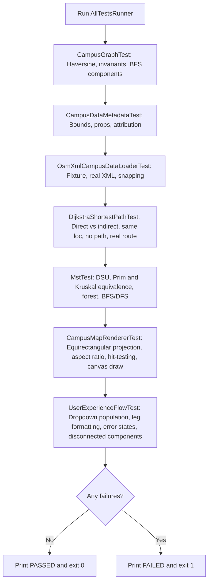

# `AllTestsRunner.java` — File Guide

## Purpose

`AllTestsRunner` is the centralized test suite runner located at `src/test/java/com/smartroute/AllTestsRunner.java`. It executes all automated unit tests in the project sequentially, summarizes passed and failed test suites, and exits with a non-zero exit code if any test fails.

## Where It Is Used

- **Package:** `com.smartroute`
- **Execution:** Run via command line:
  ```bash
  $jfxPath = "$env:USERPROFILE\.m2\repository\org\openjfx\javafx-base\21.0.8\javafx-base-21.0.8-win.jar;$env:USERPROFILE\.m2\repository\org\openjfx\javafx-graphics\21.0.8\javafx-graphics-21.0.8-win.jar;$env:USERPROFILE\.m2\repository\org\openjfx\javafx-controls\21.0.8\javafx-controls-21.0.8-win.jar"
  java --module-path $jfxPath --add-modules javafx.controls -cp "target/classes;target/test-classes" com.smartroute.AllTestsRunner
  ```

## Explicit Imports and Purpose

- `com.smartroute.algorithm.DijkstraShortestPathTest`: Shortest path routing test suite.
- `com.smartroute.algorithm.MstTest`: Minimum spanning tree (Prim, Kruskal, DSU) and traversal test suite.
- `com.smartroute.data.CampusDataMetadataTest`: Metadata test suite.
- `com.smartroute.data.OsmXmlCampusDataLoaderTest`: XML loader and destination snapping test suite.
- `com.smartroute.model.CampusGraphTest`: Graph data structure and Haversine test suite.
- `com.smartroute.ui.CampusMapRendererTest`: Vector map projection, hit-testing, and rendering test suite.
- `com.smartroute.ui.UserExperienceFlowTest`: User interaction flows, dropdown validation, error feedback, and leg formatting.

## Execution Flow



## Viva Discussion Points

- *Why have an AllTestsRunner?*  
  It guarantees that examiners, evaluators, or students can run the complete automated test suite across domain models, data parsing, routing algorithms, spanning trees, UI vector rendering, and end-to-end user experience flows in a single terminal command.
