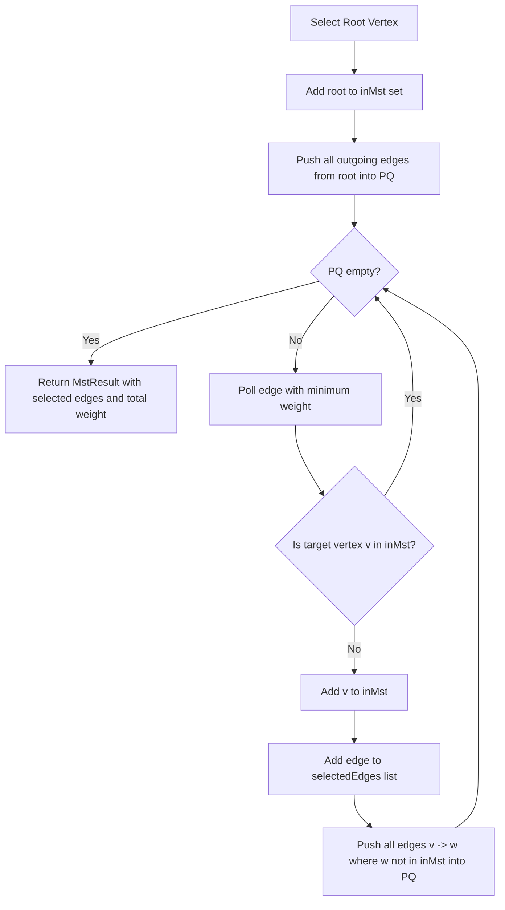

# `PrimMinimumSpanningTree.java` — File Guide

## Purpose

`PrimMinimumSpanningTree` implements Prim's greedy algorithm to calculate a Minimum Spanning Tree (or Forest) on the `CampusGraph`. It grows a minimum-weight network from a root vertex, extracting the lowest-weight cut-crossing edge at each iteration using a binary min-heap priority queue.

## Where It Is Used

- **Package:** `com.smartroute.algorithm`
- **Application Feature:** Supports the "Show Minimum Network" demonstration in the UI.
- **Unit Testing:** Verified in `MstTest`.

## Explicit Imports and Purpose

- `com.smartroute.model.CampusGraph`: Graph model providing vertices and neighbors.
- `com.smartroute.model.Road`: Road edge segment model.
- `java.util.ArrayList`, `List`: Dynamic edge list.
- `java.util.Comparator`: Comparing edge weights in the min-priority queue.
- `java.util.HashSet`, `Set`: Fast $O(1)$ set tracking of vertices already inside the tree.
- `java.util.PriorityQueue`: Binary min-heap for selecting the lowest-weight crossing edge.

## Algorithm Flow

## Complexity Analysis

| Metric | Complexity | Explanation |
|---|---|---|
| **Time Complexity** | $O((V + E) \log V)$ | Each vertex is processed once; each crossing edge is pushed to the binary heap in $O(\log V)$ time. |
| **Space Complexity** | $O(V + E)$ | Storage for the `inMst` set, selected edges, and priority queue. |

## Invariant Properties

- For any connected component with $V_c$ vertices, Prim's algorithm selects exactly $V_c - 1$ edges.
- On the same connected graph, Prim's total tree weight is mathematically identical to Kruskal's total tree weight.

## Viva Discussion Points

- *How does Prim's algorithm differ from Dijkstra's algorithm?*  
  Both use a priority queue and greedy selection. However, Dijkstra optimizes the **cumulative path distance from a single source** ($d(s, u) + w(u, v)$), whereas Prim optimizes the **weight of the individual connecting edge** ($w(u, v)$) to span all vertices with minimum total wire length.

