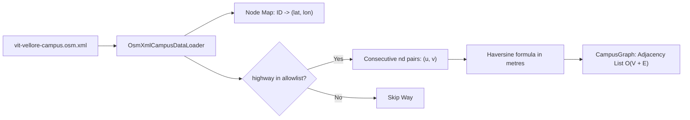

# `vit-vellore-campus.osm.xml` — File Guide

## Purpose

This file is the canonical, offline OpenStreetMap (OSM) XML snapshot of the Vellore Institute of Technology (VIT) Vellore main campus in Katpadi, Vellore, Tamil Nadu, India. It contains the raw geographic coordinate data for campus nodes, ordered way references representing paths, roads, and building perimeters, and key-value tags.

This file is stored locally in `src/main/resources/data/` so that the desktop application can parse, validate, and build the routing graph completely offline without making runtime HTTP calls to Overpass or OpenStreetMap servers.

## Where It Is Used

- **Data Loader:** Read and parsed by `com.smartroute.data.OsmXmlCampusDataLoader` during application startup.
- **Graph Construction:** Supplies the ordered node IDs and coordinates from which `com.smartroute.model.CampusGraph` builds its weighted adjacency list.
- **Provenance and Licensing:** Paired directly with [`campus-data-metadata.properties`](campus-data-metadata.properties.md).
- **Extraction Specification:** Generated per the specifications in [`docs/osm-data-specification.md`](../osm-data-specification.md) and [`data/overpass/vit-vellore-campus.overpassql`](vit-vellore-campus.overpassql.md).

## Dataset Provenance and License

| Metadata Field | Value |
|---|---|
| **Source** | OpenStreetMap (OSM) |
| **Retrieval Date** | 2026-10-22 |
| **API Endpoint** | `https://api.openstreetmap.org/api/0.6/map` |
| **Bounding Box** | South: `12.9640000`, West: `79.1500000`, North: `12.9790000`, East: `79.1670000` |
| **Licence** | Open Database License (ODbL) 1.0 ([opendatacommons.org](https://opendatacommons.org/licenses/odbl/1-0/)) |
| **Attribution** | Map data © OpenStreetMap contributors ([openstreetmap.org/copyright](https://www.openstreetmap.org/copyright)) |
| **File Size** | 1,537,726 bytes (approx. 1.50 MB) |

## XML Structure and Key Elements

The file complies with the OSM XML 0.6 schema:

1. **`<bounds>`**:
   Defines the geographic coordinate boundaries:
   ```xml
   <bounds minlat="12.9640000" minlon="79.1500000" maxlat="12.9790000" maxlon="79.1670000"/>
   ```
2. **`<node id="..." lat="..." lon="...">`**:
   Represents a geographic point with unique stable 64-bit integer ID, latitude, and longitude. May contain child `<tag k="..." v="..."/>` elements for names, entrances, and barriers.
3. **`<way id="...">`**:
   An ordered list of node references `<nd ref="..."/>` forming a polyline or polygon, plus descriptive `<tag>` elements (e.g., `highway=footway`, `name=Fleming Road`).
4. **`<relation id="...">`**:
   Logical grouping of nodes and ways forming complex entities such as multipolygon buildings or university boundary areas.

## Verified Dataset Metrics

During Stage 2 verification, the dataset was parsed and verified with the following metrics:

* **Total Nodes:** 6,084
* **Total Ways:** 1,032
* **Total Relations:** 38
* **Walkable Ways Allowed:** 391
  * `highway=footway`: 117
  * `highway=path`: 1
  * `highway=pedestrian`: 5
  * `highway=residential`: 145
  * `highway=service`: 117
  * `highway=steps`: 6
* **Rejected Highways:** 24 (e.g., `highway=primary` [11], `highway=track` [3], `highway=unclassified` [9], `highway=tertiary` [1])
* **Walkable Graph Vertices:** 1,442
* **Walkable Edges (Way Segments):** 1,576
* **Missing Node References:** **0** (All `<nd ref="..."/>` in eligible ways resolve to valid coordinate nodes).
* **Connected Components:** 31 components
  * **Largest Component:** **1,095 vertices** (encompassing the primary interconnected campus network).
* **Mapped Entrances:** 10
* **Named Campus Objects:** 188 (e.g., *EV Periyar Library*, *Anna Audi Basketball/Tennis Courts*, *Health Centre*, *Food Court*, *CDMM Building*, *Souvenier Subway*, *TT Subway*, etc.)

## DSA Concepts and Representation



* **Adjacency List Construction:** An edge is formed only between consecutive node references $u = \text{ref}[i]$ and $v = \text{ref}[i+1]$ on eligible ways.
* **Geodesic Edge Weight:** Edge weight is the real physical ground distance in metres calculated from the endpoint coordinates using the spherical Haversine formula, avoiding flat Euclidean distortion.
* **Graph Topology:** Roads that intersect physically share common node IDs in OSM, naturally creating junctions in the adjacency list without artificial geometric splicing.

## Known Data Quality Limits

1. **Crowdsourced Coverage:** OpenStreetMap data is contributed by volunteers. Some internal hostel courtyards or newly built walkways may be unmapped.
2. **Pedestrian Routing Restrictions:** While primary arterial roads were excluded, some service roads may have vehicular traffic; students are expected to exercise ordinary pedestrian caution.
3. **Indoor Paths:** Indoor navigation, room-level routing, and multi-floor building interiors are not part of OpenStreetMap or this first release.

## Viva Discussion Points

- *Why do we use an offline XML snapshot instead of querying Overpass on demand?*  
  Overpass is a shared, rate-limited public resource. Offline loading ensures instant, deterministic application startup, reproducible viva demonstrations, and eliminates internet dependency during presentation.
- *How does the graph model guarantee no disconnected or invalid node pointers?*  
  During parsing, node references are validated against the node coordinate table; our verified dataset has 0 missing references across all 391 walkable ways.

