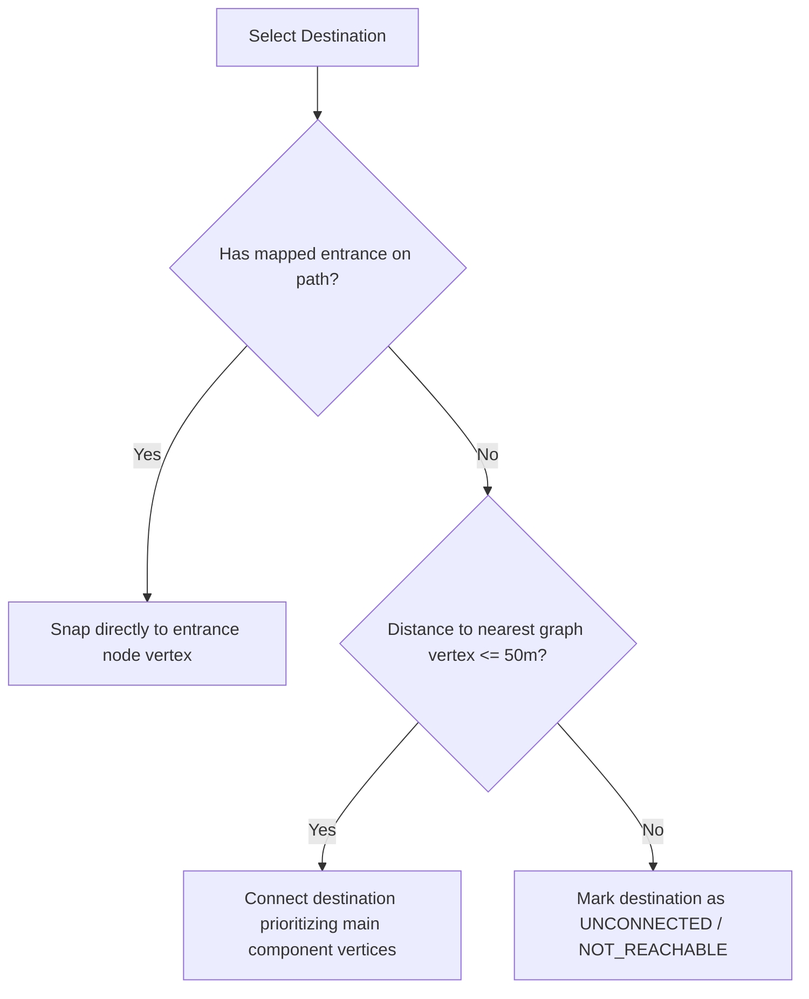

# OpenStreetMap Data Specification — VIT Vellore Campus

> **SDLC Stage:** Stage 1 — Requirements and OpenStreetMap data definition  
> **Source-of-truth document:** [`plan.md`](../plan.md)  
> **Target query file:** [`data/overpass/vit-vellore-campus.overpassql`](../data/overpass/vit-vellore-campus.overpassql)

---

## 1. Scope and Objective

This specification defines the geographic boundaries, entity filters, destination snapping rules, metadata schema, and verification criteria for integrating real OpenStreetMap (OSM) walking geometry into the **Smart Route Finder** application for the VIT Vellore campus (PAMCA501 Data Structures and Algorithms).

This document serves as the formal definition gate for **Stage 1**. Stage 2 (OSM extraction) and Stage 3 (Graph model architecture) must strictly adhere to the specifications detailed below.

---

## 2. Geographic Boundary (Bounding Box)

### 2.1 Bounding Box Coordinates
The VIT Vellore main campus (Katpadi, Vellore, Tamil Nadu, India) covers approximately 372 acres bounded by Katpadi-Thiruvalam Road to the south, Katpadi railway lines to the west, agricultural/residential buffers to the north, and student hostels/sports grounds to the east.

To ensure all interconnected walkways, gates, and student facilities are fully captured without cutting peripheral campus ways:

| Boundary Parameter | Value | Geographic Description |
|---|---|---|
| **South (Min Latitude)** | `12.9640` | South of Main Gate, Green Circle approach, and Tiruvalam Road |
| **West (Min Longitude)** | `79.1500` | West of Katpadi railway approach and campus western boundary |
| **North (Max Latitude)** | `12.9790` | North of Men's Hostels (Q/P/R blocks) and outdoor sports grounds |
| **East (Max Longitude)** | `79.1670` | East of Silver Jubilee Tower (SJT), Ladies Hostels, and eastern perimeter |

* **Overpass QL BBox format `(south, west, north, east)`:**  
  `12.9640, 79.1500, 12.9790, 79.1670`
* **Coverage Span:** ~1.67 km (North–South) by ~1.84 km (East–West).

---

## 3. Walkable-Way Allowlist and Access Filter

OSM ways represent real-world physical features. Not all ways tagged `highway` are appropriate or safe for student walking routes. The Java importer (`OsmXmlCampusDataLoader`) must filter OSM ways based on explicit rules:

### 3.1 Allowed `highway` Types
A way is accepted into the walking graph if its `highway` tag matches any of the following:

| `highway` Tag Value | Category | Campus Routing Rationale |
|---|---|---|
| `footway` | Primary Walking | Dedicated pedestrian footpaths, corridors, and paved walkways. |
| `path` | Primary Walking | Informal or formal unpaved/paved walking paths across campus quads. |
| `pedestrian` | Primary Walking | Pedestrianized plazas (e.g., surrounding Academic blocks, TT, SJT). |
| `steps` | Primary Walking | Outdoor stairs, ramps, and elevation transitions between campus levels. |
| `service` | Shared Access | Internal campus driveways, delivery alleys, and shared vehicle-pedestrian service roads. |
| `residential` | Shared Access | Internal access roads servicing hostel complexes and staff quarters. |
| `living_street` | Shared Access | Low-speed shared-use streets prioritizing pedestrians. |
| `crossing` | Pedestrian Crossing | Zebra crossings and pedestrian links connecting paths across campus roads. |
| `unclassified` | Campus Road | Internal campus access roads connecting faculties and hostels. |
| `track` | Unpaved Track | Minor service tracks and unpaved pathways linking outer sports areas. |

### 3.2 Explicit Exclusions and Access Denylist
A way is **rejected** if any of the following conditions are met:

1. **Explicit Pedestrian Prohibition:**
   * `foot=no` or `foot=private`
   * `access=no`
2. **High-Speed / Non-Pedestrian Highways:**
   * `highway=motorway`, `trunk`, `primary`, `secondary` (external arterial roads)
   * `highway=construction` or any element with `construction=*`
3. **Impassable Barriers:**
   * Ways or nodes with `barrier=wall`, `barrier=fence` (unless an entrance/gate node exists with `access!=no`).
4. **Campus User Access Policy:**
   * Ways tagged with `access=private` or `access=permit` that are internal to campus are treated conservatively: included only if tagged `foot=yes` or `foot=permissive` indicating campus-community walking access.

---

## 4. Destination Types and Snapping Policy

### 4.1 Target Destination Categories
The destination registry will recognize key campus facilities by querying named nodes, entrances, and building outlines:

1. **Entrances & Access Points:** Main Gate, Katpadi Gate, East Gate, Hostels Entry Gates.
2. **Academic & Research Towers:** Main Building (MB), Technology Tower (TT), Silver Jubilee Tower (SJT), SMV, CBMR, TT Annex, Architecture Block.
3. **Amenities & Services:** Central Library, Anna Auditorium, Food Courts / Canteens, Health / Medical Centre, Indoor Sports Complex.
4. **Hostel Complexes:** Men's Hostels (MH A through T blocks), Ladies Hostels (LH A through G blocks).

### 4.2 Snapping Policy to Graph Vertices
Destinations frequently exist as independent POI nodes or building polygons whose centroids do not coincide with an OSM way node. The snapping policy governs how destinations attach to the walking graph:



1. **Priority 1 (Mapped Entrance):** If an entrance node (`node["entrance"]`) exists for the building and lies on an eligible path, snap directly to that vertex.
2. **Priority 2 (Main Component Priority Snapping):** If no entrance is mapped on the path, calculate the Haversine distance from the POI coordinate to every vertex in the walkable graph.
   * **Maximum Snapping Threshold:** **`50.0 metres`** (`destination.max_snap_distance_meters`).
   * When finding the nearest candidate vertex within 50.0m, prioritize vertices that belong to the main campus connected component (containing over 1,300 vertices). This ensures paths connect to the primary campus spine rather than isolated decorative micro-islands.
   * If `min_distance <= 50.0m`, link the destination to that closest graph vertex.
3. **Priority 3 (Honest Disconnection):** If `min_distance > 50.0m`, the destination is marked `UNCONNECTED`. The UI notifies the user that no safe, mapped walking path connects to this destination. **Never fabricate shortcuts across unmapped buildings or grounds.**

---

## 5. Segment Weight Calculation (Haversine Formula)

Segment distances must be calculated from geographic coordinates in metres, **not** screen pixels or arbitrary estimates.

### 5.1 Geodesic Haversine Formula
For two consecutive way nodes $A(\phi_1, \lambda_1)$ and $B(\phi_2, \lambda_2)$ in radians:

$$\Delta \phi = \phi_2 - \phi_1$$
$$\Delta \lambda = \lambda_2 - \lambda_1$$
$$a = \sin^2\left(\frac{\Delta \phi}{2}\right) + \cos(\phi_1)\cos(\phi_2)\sin^2\left(\frac{\Delta \lambda}{2}\right)$$
$$c = 2 \cdot \text{atan2}\left(\sqrt{a}, \sqrt{1 - a}\right)$$
$$d = R \cdot c$$

* Earth mean radius: $R = 6,371,000 \text{ metres}$.
* Minimum segment threshold: Any segment where $d < 0.1\text{ m}$ (duplicate consecutive nodes) is logged and skipped to avoid zero-weight loops.

---

## 6. Graph Model Invariants

1. **Vertices ($V$):** Every unique OSM node referenced by at least one eligible way segment. Identified uniquely by `long osmNodeId`.
2. **Edges ($E$):** For an eligible way with ordered nodes $[n_0, n_1, \dots, n_k]$, undirected edges are added between $(n_i, n_{i+1})$ with weight $d(n_i, n_{i+1})$.
3. **No Crossing Shortcuts:** If two ways cross geographically without a shared OSM node ID, they **must not** be connected in the graph.
4. **Adjacency Representation:** Adjacency list stored via `Map<Long, List<Road>>` with `HashMap` and `ArrayList`, ensuring efficient lookup and memory scaling `O(V + E)`.

---

## 7. Snapshot Provenance Schema (`campus-data-metadata.properties`)

When the raw snapshot is saved in Stage 2 as `src/main/resources/data/vit-vellore-campus.osm.xml`, the accompanying metadata file `src/main/resources/data/campus-data-metadata.properties` must contain the following keys:

```properties
# Snapshot Provenance
source.name=OpenStreetMap
source.url=https://www.openstreetmap.org
source.query.file=data/overpass/vit-vellore-campus.overpassql
source.export.date=YYYY-MM-DD
source.extractor=Overpass Turbo

# Bounding Box
bbox.south=12.9640
bbox.west=79.1500
bbox.north=12.9790
bbox.east=79.1670

# Licensing & Attribution
licence.name=Open Database License (ODbL) 1.0
licence.url=https://opendatacommons.org/licenses/odbl/1-0/
attribution.text=Map data © OpenStreetMap contributors
attribution.url=https://www.openstreetmap.org/copyright

# Ingestion Filter Configuration
filter.allowed_highways=footway,path,pedestrian,steps,service,residential,living_street
filter.excluded_foot=no,private
filter.excluded_access=no
destination.max_snap_distance_meters=35.0

# Known Limitations
known.limitations=OSM data is crowdsourced; internal building corridors, underpasses, and temporary construction detours may not be mapped.
```

---

## 8. Measurable MVP Acceptance Criteria

| ID | Acceptance Criterion | Verification Method |
|---|---|---|
| **AC-1** | Known start and destination on a connected component produces the verified shortest sequence of way nodes. | Unit test with hand-calculated graph fixture. |
| **AC-2** | Total path distance equals the exact sum of consecutive segment Haversine distances. | Floating-point delta assertion ($\pm 0.1\text{ m}$). |
| **AC-3** | Choosing identical start and destination returns distance $0.0\text{ m}$ and a 1-node path. | Unit test verifying boundary handling. |
| **AC-4** | Destination in a disconnected component or exceeding $35.0\text{ m}$ snap distance returns explicit `NO_PATH` status. | Automated test on disconnected fixture graph; no infinite loops or crashes. |
| **AC-5** | Disconnected ways without a shared node do not create false routes. | Fixture test with crossing lines lacking shared junction node. |
| **AC-6** | Application displays legible attribution `"Map data © OpenStreetMap contributors"` linked to `https://www.openstreetmap.org/copyright`. | Manual visual check and UI inspection. |

